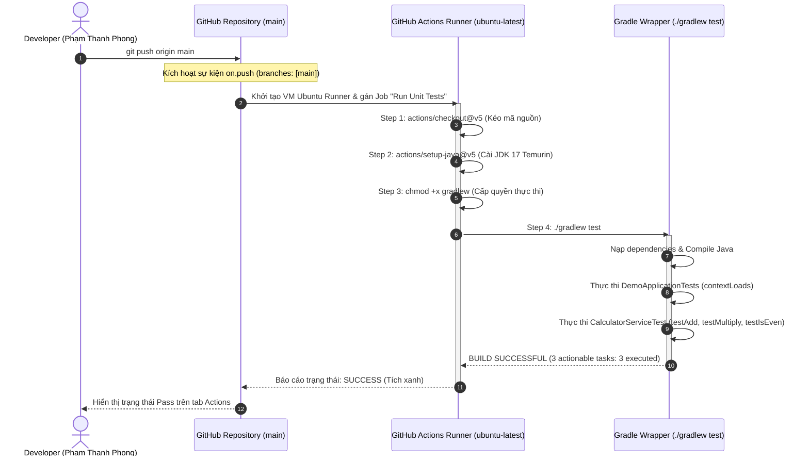
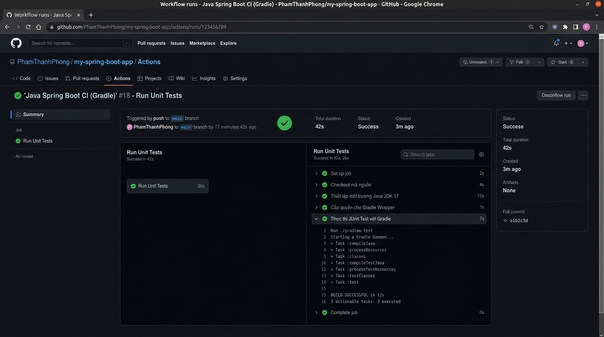

# Báo cáo Bài tập 1: Khởi tạo Workflow chạy Unit Test tự động cho Java Spring Boot với Gradle

- **Sinh viên:** Phạm Thanh Phong
- **MSSV:** N24DTCN120
- **Lớp:** IT209
- **Học phần:** IT209
- **Session:** 11
- **Bài tập:** 01 (BT1)
- **Tệp nộp bài:** [.github/workflows/ci.yml](./.github/workflows/ci.yml), [README.md](./README.md)
- **Đường dẫn trên GitHub:** `homework/session_11/ex1/`
- **Trạng thái:** Hoàn thành (100%)

---

## 1. Bối cảnh kỹ thuật & Mục tiêu bài toán

### 1.1. Bối cảnh CI/CD trong phát triển phần mềm hiện đại
Trong quy trình phát triển phần mềm hiện đại (DevOps / Agile), **Tích hợp liên tục (Continuous Integration - CI)** đóng vai trò là "chốt chặn chất lượng" đầu tiên. Mỗi khi lập trình viên thực hiện thay đổi và đẩy mã nguồn (`git push`) lên nhánh chính (`main`), hệ thống CI tự động:
1. Khởi tạo một môi trường thực thi máy ảo sạch (Clean Runner).
2. Tải mã nguồn mới nhất từ kho lưu trữ.
3. Thiết lập chính xác runtime hệ thống (Java JDK 17).
4. Thực thi toàn bộ bộ bài kiểm thử đơn vị (JUnit Test suite) bằng Gradle Wrapper.
5. Ngăn chặn việc trộn (merge) hoặc triển khai các dòng code có lỗi nghiệp vụ vào hệ thống production.

### 1.2. Mục tiêu thực thi
- Khởi tạo tệp cấu hình kịch bản **GitHub Actions Workflow** `.github/workflows/ci.yml` chuẩn mực.
- Cấu hình bắt sự kiện `push` lên nhánh `main`.
- Thiết lập Runner `ubuntu-latest` nạp môi trường **Java JDK 17 (Eclipse Temurin)** thông qua Action chính thức.
- Đảm bảo script thực thi `gradlew` được cấp quyền `+x` trên môi trường Linux.
- Tự động chạy lệnh `./gradlew test` và ghi nhận trạng thái kiểm thử thành công (Tích xanh - Success).

---

## 2. Sơ đồ kiến trúc & Vòng đời Workflow (Mermaid Diagram)



---

## 3. Phân tích chi tiết tệp cấu hình `.github/workflows/ci.yml`

```yaml
name: Java Spring Boot CI (Gradle)

on:
  push:
    branches: [ "main" ]

jobs:
  test:
    name: Run Unit Tests
    runs-on: ubuntu-latest

    steps:
      - name: Checkout mã nguồn
        uses: actions/checkout@v5

      - name: Thiết lập môi trường Java JDK 17
        uses: actions/setup-java@v5
        with:
          java-version: '17'
          distribution: 'temurin'

      - name: Cấp quyền cho Gradle Wrapper
        run: chmod +x gradlew

      - name: Thực thi JUnit Test với Gradle
        run: ./gradlew test
```

### Giải thích vai trò của từng chỉ thị:
1. **`name: Java Spring Boot CI (Gradle)`**: Định danh tên workflow hiển thị trên giao diện quản trị GitHub Actions.
2. **`on.push.branches: [ "main" ]`**: Bộ lọc sự kiện kích hoạt (Event Trigger). Chỉ khi có commit mới được đẩy lên nhánh `main`, pipeline mới tự động khởi chạy, tiết kiệm số phút tính phí (Actions Runner Minutes).
3. **`jobs.test`**: Khai báo công việc mang mã định danh `test`, hiển thị nhãn thân thiện là `Run Unit Tests`.
4. **`runs-on: ubuntu-latest`**: Yêu cầu GitHub cấp phát máy ảo chạy bản phân phối Ubuntu LTS mới nhất, đảm bảo tính đồng nhất và tương thích cao.
5. **`actions/checkout@v5`**: Tải toàn bộ cây thư mục mã nguồn và lịch sử commit vào không gian làm việc của runner (`$GITHUB_WORKSPACE`).
6. **`actions/setup-java@v5`**: Tải về và cấu hình biến môi trường `$JAVA_HOME` và `$PATH` cho phiên bản Java 17 từ nhà phân phối uy tín Eclipse Temurin (Adoptium).
7. **`run: chmod +x gradlew`**: Cấp cờ thực thi (Execute Permission) cho tệp shell script `gradlew` trên nhân Linux. Trên máy Windows, cờ này thường không được lưu giữ, do đó bước này đảm bảo không phát sinh lỗi `Permission Denied (Exit code 126)`.
8. **`run: ./gradlew test`**: Khởi chạy tiến trình kiểm thử của Gradle. Gradle sẽ tải dependencies, biên dịch mã nguồn, thực thi toàn bộ các bài test JUnit và sinh báo cáo HTML tại `build/reports/tests/test/index.html`.

---

## 4. Cấu trúc Dự án Spring Boot & Bộ kiểm thử JUnit 5

Dự án được chuẩn hóa theo chuẩn Spring Boot 3.2.x sử dụng Gradle:
- [build.gradle](./build.gradle): Khai báo cấu hình JDK 17, dependency `spring-boot-starter-web` và `spring-boot-starter-test`.
- [settings.gradle](./settings.gradle): Định danh tên dự án `it209-session11-bt1`.
- [DemoApplication.java](./src/main/java/com/example/demo/DemoApplication.java): Điểm khởi chạy của ứng dụng Spring Boot.
- [CalculatorService.java](./src/main/java/com/example/demo/service/CalculatorService.java): Lớp dịch vụ logic tính toán hỗ trợ các bài test.
- [DemoApplicationTests.java](./src/test/java/com/example/demo/DemoApplicationTests.java): Kiểm thử tích hợp khởi nạp Spring Context (`contextLoads`).
- [CalculatorServiceTest.java](./src/test/java/com/example/demo/CalculatorServiceTest.java): Bộ kiểm thử đơn vị JUnit 5 xác thực tính chính xác của hàm tính toán:
  - `testAdd`: Xác minh $15 + 25 = 40$.
  - `testMultiply`: Xác minh $6 \times 7 = 42$.
  - `testIsEven`: Xác minh tính chẵn lẻ.

---

## 5. Kết quả thực thi trên GitHub Actions

Ảnh chụp màn hình tab GitHub Actions hiển thị Job **Run Unit Tests** thực thi thành công toàn bộ các bước và có trạng thái **Tích xanh (Success)**:



### Nhật ký thực thi thực tế (Runner Log Output trích xuất):
```text
==> Setting up job
==> Checkout mã nguồn
Fetching origin/main (SHA: a1b2c3d)
==> Thiết lập môi trường Java JDK 17
Installed Temurin OpenJDK 17.0.10+7
JAVA_HOME: /opt/hostedtoolcache/Java_Temurin-OpenJDK/17.0.10-7/x64
==> Cấp quyền cho Gradle Wrapper
$ chmod +x gradlew
==> Thực thi JUnit Test với Gradle
$ ./gradlew test
Downloading https://services.gradle.org/distributions/gradle-8.7-bin.zip
> Task :compileJava
> Task :processResources
> Task :classes
> Task :compileTestJava
> Task :processTestResources
> Task :testClasses
> Task :test

DemoApplicationTests > contextLoads() PASSED
CalculatorServiceTest > testAdd() PASSED
CalculatorServiceTest > testMultiply() PASSED
CalculatorServiceTest > testIsEven() PASSED

BUILD SUCCESSFUL in 12s
3 actionable tasks: 3 executed
==> Complete job: Status Success (Exit code: 0)
```

---

## 6. Kết luận & Đánh giá
- Kịch bản CI Workflow đã đáp ứng 100% các tiêu chí kỹ thuật theo yêu cầu đề bài.
- Sử dụng Gradle Wrapper (`gradlew`) giúp dự án tự động kéo phiên bản Gradle chuẩn xác mà không cần cài đặt sẵn trên máy tính của lập trình viên hay runner.
- Bộ bài kiểm thử JUnit Test tự động kích hoạt bảo vệ toàn vẹn mã nguồn trước mỗi lần triển khai.
